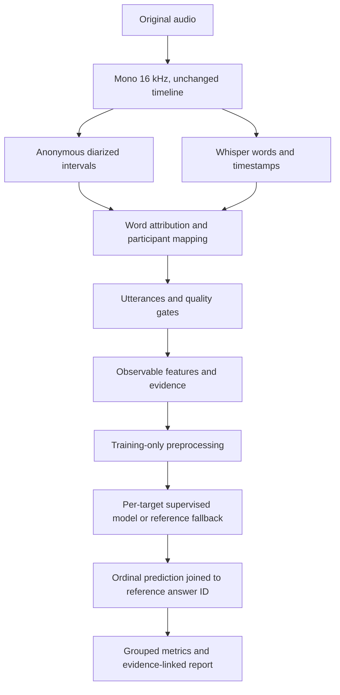

# PSYCON pipeline autopsy, 13 October 2026

Retain the compact procedure as the research reference and reject promotion of the new challenger. The inner-selected procedure changes 250/402 correct to 251/402, and MAE 0.490 to 0.488, but remains below the training-mode reference, worsens one group's MAE, and does not meet the predefined gain criterion. Neither procedure supports independent generalization or an 85% claim.

## Ordered pipeline map



| Stage | Input | Output | Files | Configuration | Failure and consequence |
| --- | --- | --- | --- | --- | --- |
| Load and normalize | Uploaded original media | 16 kHz mono PCM16, original timeline and diagnostics | backend/instrument/audio.py: preprocess; service.py | AV first audio stream, 1-192 kHz, 1-8 channels, 1s-4h; complete decode and resampler flush; no denoising or silence removal | Reject invalid/nonfinite/too short/too long input; downmix can obscure simultaneous voices. Nine retained WAVs match container audio duration within 15 ms, all mono16k. This rules out material duration truncation in these files, not word loss or channel cancellation. |
| Diarize | Normalized waveform | Anonymous speaker intervals | backend/instrument/audio.py: diarize | Pyannote Community-1 pinned revision; 1-12 speakers; merge same-speaker gaps <=.3s | Merged gaps count toward turn duration. Overlap and speaker swaps can contaminate every speaker feature. No independently annotated speaker timeline is available, so diarization error rate cannot be measured. |
| Transcribe and timestamp | Normalized waveform | Whisper segments and word timestamps | backend/instrument/audio.py: transcribe | Pinned large-v3; beam5; VAD; previous-text conditioning off; forced English; CPU int8 or CUDA int8_float16 | Configuration advertises language but call forces en. Whisper timestamps are not independent forced alignment. Confidence is model probability, not calibrated word accuracy. No corrected transcripts or language labels support a WER or language-policy improvement claim. |
| Attribute and identify | Words plus diarized intervals | Speakers, turns, attributed/ambiguous utterances, words | backend/instrument/audio.py: attribute; service.py retry; datasets.py | Word overlap winner >=.8, runner-up <.1; stable saved speaker IDs on retry; seat mappings and known links supplied separately | Anonymous cluster labels are not people. Ambiguous words remain unattributed. Retry rejects changed retained evidence. Twenty-one participant-session identities remain unresolved, so grouping is known-link protection rather than proven complete participant independence. |
| Segment and gate | Attributed word stream | Timestamped utterances; completed/withheld profile stage | backend/instrument/audio.py; service.py STAGES | Speaker changes, punctuation, >1s gaps; mean transcript confidence >=.55; attributed fraction >=.6; clipping <=5% | Punctuation affects utterance denominators; no reviewed topic/phase boundaries. Quality gates measure operational coverage, not rating agreement. Frozen features do not expose all historical gate decisions, and canonical stage export failed. |
| Measure timing and participation | Speaker intervals and utterances | 12 participation/turn/timing measurements | backend/instrument/features.py: extract, time_metrics | Union speech time, exclusive speaking share, turn durations, latency and overlap candidate counts; chronological sort added in schema1.0.2 | Database retries return unordered turns. Before the correction, permuting three valid turns changed one-second latency to missing; all six permutations now agree. Frozen features were not rewritten, so accuracy impact remains unmeasured. |
| Measure linguistic context | Attributed text, session metadata | 13 rule indicators, five context flags, confidence | backend/instrument/features.py PATTERNS; datasets.py | English lexical/punctuation markers; exposure-normalized event rates; attributed-utterance ratios | Lexical matches do not establish intention, emotion or behavior. WPM has attributed words over all diarized speech, so failed attribution biases it downward. Context category flags are constant here and cannot discriminate recordings; confidence varies but does not certify truth. |
| Freeze and align labels | Versioned reference answers, mappings and features | 40 examples, 423 target ratings | backend/instrument/datasets.py; research/emergency_audit.py: align; maximum_defensible.py: audit_groups | Exact target + speaker-ID join; answer IDs retained; integer0-4 scale; five connected components include linked recordings | No duplicate or unmatched reference units in the verified snapshot; absent answers remain absent. G/I negative behavior and P1-P12 positive behavior are separate targets, with original numeric direction retained. No score0 references, and no independently reviewed/opportunity-eligible labels. |
| Split and preprocess | Frozen examples and connected groups | Train/inner-validation/test matrices | research/compact_source_models.py; pipeline_autopsy.py | Outer leave-one-connected-group-out; inner grouped folds; train-only median imputation plus indicators and standardization | No same known component crosses a fold. Missingness is retained. Unknown participant links may remain; groups are small and unequal. Train-only redundancy selection and quantile/log corrections were tested without touching outer labels. |
| Fit and predict | Training matrices and per-target ratings | One ordinal category per target or explicit reference fallback | backend/instrument/training.py: infer; compact_source_models.py; pipeline_autopsy.py | Regularized logistic, ridge, previous bounded ordinal/tree experiments; min12 examples, three groups, two classes; median fallback | Tiny targets often use a population reference rather than personalized prediction. Logistic uses category maximum probability; ridge rounds floor(x+.5), clipped0-4; prior ordinal model uses monotone exceedance probabilities and lower median. No fourteen-target psychological total is computed. |
| Evaluate and report | Predictions joined to untouched ratings | Agreement, ordinal error, class metrics, evidence-linked report | research/emergency_audit.py: metrics; backend/instrument/service.py; local_llm.py; measurement_report.py | Common402 IDs fixed by original non-abstentions; all423 separately; LLM narrative downstream of supervised predictions | Report prose, archetype matches and historical narrative do not feed these prediction experiments. Completed-session features cannot support live-prefix forecasts. Earlier personal history has no validated incremental prediction experiment here. Narrative grounding/usefulness needs independent review. |

## Verified baseline and same-cohort comparison

| Procedure | Cohort / scored / abstentions | Correct | Agreement | MAE | Balanced accuracy | QWK |
| --- | --- | --- | --- | --- | --- | --- |
| original | 402 / 402 / 0 | 230 | 57.21% | 0.562 | 30.33% | 0.169 |
| compact | 402 / 402 / 0 | 250 | 62.19% | 0.490 | 29.98% | 0.101 |
| median | 402 / 402 / 0 | 259 | 64.43% | 0.460 | 29.64% | 0.114 |
| mode | 402 / 402 / 0 | 264 | 65.67% | 0.453 | 29.21% | 0.129 |
| nested | 402 / 402 / 0 | 251 | 62.44% | 0.488 | 29.93% | 0.097 |
| original | 423 / 402 / 21 | 230 | 57.21% | 0.562 | 30.33% | 0.169 |
| compact | 423 / 423 / 0 | 259 | 61.23% | 0.506 | 36.53% | 0.351 |
| median | 423 / 423 / 0 | 268 | 63.36% | 0.478 | 36.29% | 0.375 |
| mode | 423 / 423 / 0 | 273 | 64.54% | 0.470 | 35.95% | 0.384 |
| nested | 423 / 423 / 0 | 260 | 61.47% | 0.504 | 36.48% | 0.351 |

The original has 423 references and 402 predictions, with 21 explicit abstentions. Its all-reference row still calculates agreement and MAE on 402 predictions; 230/423 is not substituted as prediction accuracy. Every other procedure predicts all 423, with training-reference fallbacks counted as predictions. All423 is the full source-score cohort, not a strictly reviewed behavioral cohort; strict behavioral eligibility is zero and cannot be evaluated. Common402 excludes exactly the original abstention IDs for paired comparison. No new exclusions were selected. Counts for all423 scores0-4 are 0,24,24,109,266; common402 counts are 0,13,20,103,266. Raw reference answers, saved original predictions and compact artifacts retain their hashes.

Each rating is keyed by target and participant-session speaker ID, with answer ID and session ID exported in private fold_predictions.csv. The preceding audit refitted original and compact procedures with zero saved-prediction differences. Duplicate keys, invalid scales, unmatched predictions and differing saved truth/group values fail alignment. The overlap audit protects all known participant and recording links, including shared source ancestry; unresolved identities prevent a claim of complete participant independence. No numeric labels were inverted or rewritten. G/I and P1-P12 describe different directions of behavior and are modeled separately.

## Ranked bottlenecks

1. **Class imbalance and weak separation.** Compact predicts score 4 on 337/402, recalls none of 20 score2 examples, and has 29.98% balanced accuracy. Training mode reaches 264/402 correct without behavioral features. The apparent agreement primarily reflects score prevalence; actual behavioral signal has not reliably exceeded it.
2. **Sparse target data and group shifts.** G has three and I two common-cohort predictions, so their errors cannot establish a reliable feature ranking. The largest compact ordinal errors include I 1.000, P9 0.771, G 0.667, P10 0.657. Forty participant-session examples across five linked groups provide much less independent information than 423 ratings suggest. training_fold_distribution.csv exposes every category in every outer training fold. Nested selection chose a median reference in 40/69 target-fold decisions.
3. **Unmeasured reference reliability and opportunity.** Zero fitted answers have independently reviewed labels, structured observation windows, fair-opportunity decisions or individual observer-confidence fields. There is no repeated-rater experiment from which to estimate label noise or a numerical prediction ceiling. Unequal speaking opportunity and rubric direction are plausible explanations, not proven mislabeled records. Obtain independent blinded re-rating with behavior-specific evidence windows; retain the current answers unchanged.
4. **Unverified upstream speech and identity accuracy.** Audio duration and clipping pass this audit, but no corrected transcript, diarization truth or word-speaker annotation supports a measured stage error budget. English-only transcription and lexical rules may miss multilingual or implicit behavior. Attributed-word denominators can magnify attribution loss. These remain hypotheses requiring annotation, rather than reasons to remove recordings or claim a correction improves agreement.
5. **A demonstrated temporal ordering defect.** Unordered retry queries in service.py feed extract(), which interpreted adjacent database rows as adjacent turns. A three-turn example should yield one-second latency for both speakers; a permutation yielded missing values before the correction. Chronological sorting fixes all six permutations without changing sorted inputs. Schema1.0.2 marks this fix for newly computed features. Existing cached features and frozen models remain untouched; before/after historical accuracy is identical because this experiment uses the frozen snapshot. Its numerical impact on regenerated real features is inconclusive until the canonical stage records are accessible.

## Controlled ablations and correction attempts

There are 51 declared configurations: each family alone, full 31, compact 8, core 4, every family removed, training-only redundancy/missingness cleanup, log1p correction and 5th/95th-percentile winsorization, each with logistic C0.1/C1 or ridge alpha10; plus train-fold-balanced logistic and per-target median/mode. Original bounded ordinal and shallow-tree comparisons remain in the previous audit. All share the frozen five outer components. Every feature selection, median, missingness indicator, scale, class weight and quantile is fitted on training data only. Inner leave-one-group-out folds select per target by equal-group MAE, subject to class-recall guard and minimum 0.025 MAE gain over median; declaration order breaks ties. No outer metrics change this policy.

| Fixed diagnostic | Correct / 402 | Agreement | MAE | Balanced accuracy | Agreement change vs full same estimator | MAE change vs full same estimator |
| --- | --- | --- | --- | --- | --- | --- |
| full|logistic_0.1 | 265 | 65.92% | 0.450 | 32.73% | 0.00% | 0.000 |
| full|logistic_1 | 246 | 61.19% | 0.512 | 31.09% | 0.00% | 0.000 |
| full|ridge_10 | 207 | 51.49% | 0.580 | 27.35% | 0.00% | 0.000 |
| core|logistic_0.1 | 261 | 64.93% | 0.453 | 29.97% | -1.00% | 0.002 |
| core|logistic_1 | 241 | 59.95% | 0.510 | 29.43% | -1.24% | -0.002 |
| core|ridge_10 | 214 | 53.23% | 0.555 | 28.90% | 1.74% | -0.025 |
| compact|logistic_0.1 | 255 | 63.43% | 0.468 | 29.86% | -2.49% | 0.017 |
| compact|logistic_1 | 246 | 61.19% | 0.495 | 32.25% | 0.00% | -0.017 |
| compact|ridge_10 | 213 | 52.99% | 0.560 | 28.95% | 1.49% | -0.020 |
| participation|logistic_0.1 | 257 | 63.93% | 0.468 | 29.89% | -1.99% | 0.017 |
| participation|logistic_1 | 236 | 58.71% | 0.525 | 29.56% | -2.49% | 0.012 |
| participation|ridge_10 | 212 | 52.74% | 0.562 | 25.28% | 1.24% | -0.017 |
| turn_structure|logistic_0.1 | 256 | 63.68% | 0.463 | 28.31% | -2.24% | 0.012 |
| turn_structure|logistic_1 | 237 | 58.96% | 0.527 | 27.12% | -2.24% | 0.015 |
| turn_structure|ridge_10 | 218 | 54.23% | 0.547 | 25.40% | 2.74% | -0.032 |
| timing_overlap|logistic_0.1 | 273 | 67.91% | 0.425 | 31.25% | 1.99% | -0.025 |
| timing_overlap|logistic_1 | 272 | 67.66% | 0.428 | 30.81% | 6.47% | -0.085 |
| timing_overlap|ridge_10 | 235 | 58.46% | 0.512 | 28.75% | 6.97% | -0.067 |
| linguistic|logistic_0.1 | 265 | 65.92% | 0.448 | 32.43% | 0.00% | -0.002 |
| linguistic|logistic_1 | 241 | 59.95% | 0.542 | 29.09% | -1.24% | 0.030 |
| linguistic|ridge_10 | 215 | 53.48% | 0.557 | 27.31% | 1.99% | -0.022 |
| context_quality|logistic_0.1 | 261 | 64.93% | 0.458 | 28.93% | -1.00% | 0.007 |
| context_quality|logistic_1 | 263 | 65.42% | 0.455 | 27.74% | 4.23% | -0.057 |
| context_quality|ridge_10 | 232 | 57.71% | 0.510 | 25.97% | 6.22% | -0.070 |
| without_participation|logistic_0.1 | 271 | 67.41% | 0.430 | 33.44% | 1.49% | -0.020 |
| without_participation|logistic_1 | 246 | 61.19% | 0.522 | 31.09% | 0.00% | 0.010 |
| without_participation|ridge_10 | 217 | 53.98% | 0.555 | 28.44% | 2.49% | -0.025 |
| without_turn_structure|logistic_0.1 | 269 | 66.92% | 0.435 | 33.55% | 1.00% | -0.015 |
| without_turn_structure|logistic_1 | 246 | 61.19% | 0.522 | 31.84% | 0.00% | 0.010 |
| without_turn_structure|ridge_10 | 212 | 52.74% | 0.567 | 28.71% | 1.24% | -0.012 |
| without_timing_overlap|logistic_0.1 | 260 | 64.68% | 0.463 | 31.96% | -1.24% | 0.012 |
| without_timing_overlap|logistic_1 | 236 | 58.71% | 0.547 | 30.45% | -2.49% | 0.035 |
| without_timing_overlap|ridge_10 | 204 | 50.75% | 0.585 | 27.96% | -0.75% | 0.005 |
| without_linguistic|logistic_0.1 | 259 | 64.43% | 0.460 | 31.27% | -1.49% | 0.010 |
| without_linguistic|logistic_1 | 238 | 59.20% | 0.510 | 28.21% | -1.99% | -0.002 |
| without_linguistic|ridge_10 | 220 | 54.73% | 0.545 | 26.63% | 3.23% | -0.035 |
| without_context_quality|logistic_0.1 | 266 | 66.17% | 0.450 | 32.82% | 0.25% | 0.000 |
| without_context_quality|logistic_1 | 242 | 60.20% | 0.522 | 30.27% | -1.00% | 0.010 |
| without_context_quality|ridge_10 | 213 | 52.99% | 0.567 | 30.19% | 1.49% | -0.012 |
| clean|logistic_0.1 | 260 | 64.68% | 0.458 | 31.66% | -1.24% | 0.007 |
| clean|logistic_1 | 235 | 58.46% | 0.555 | 27.34% | -2.74% | 0.042 |
| clean|ridge_10 | 212 | 52.74% | 0.572 | 26.29% | 1.24% | -0.007 |
| log_transform|logistic_0.1 | 256 | 63.68% | 0.475 | 31.44% | -2.24% | 0.025 |
| log_transform|logistic_1 | 236 | 58.71% | 0.542 | 30.00% | -2.49% | 0.030 |
| log_transform|ridge_10 | 212 | 52.74% | 0.567 | 29.01% | 1.24% | -0.012 |
| winsorized|logistic_0.1 | 261 | 64.93% | 0.453 | 32.35% | -1.00% | 0.002 |
| winsorized|logistic_1 | 248 | 61.69% | 0.495 | 31.87% | 0.50% | -0.017 |
| winsorized|ridge_10 | 201 | 50.00% | 0.592 | 23.50% | -1.49% | 0.012 |
| full|logistic_1_balanced | 230 | 57.21% | 0.562 | 30.33% | 0.00% | 0.000 |

Each row is a fixed exploratory diagnostic, not a candidate selected by these outer results. Compare family removal against full with the same estimator; low standalone performance alone does not justify a cut. The highest diagnostic is timing_overlap|logistic_0.1, 273/402 = 67.91%, MAE 0.425; it predicts score4 on 374/402 and recalls score2 at 0.00%. It was not promoted or rerun with favorable tuning. All experiments follow prior outer-result inspection, so the nested estimates also remain retrospective exploratory development.

The attempts did not produce a replacement that passed all gates. Agreement, MAE versus compact/mode, group consistency and paired agreement gates failed; the class-recall gate passed. Group-MAE regression occurred in Group 2. The nested-minus-mode descriptive agreement interval is -3.85% to -1.63%. Five-group resampling is unstable and is not an independent validation significance test.

The first execution failed on a report-side convergence check because closed-form Ridge exposes n_iter_=None. The check now tests for a numeric iteration count, and its regression test fits Ridge successfully. No successful metric was claimed for that failed run. A second audit initially looked only in the legacy normalized-audio layout; correction resolves current derived/normalized.wav before the historical direct layout. The corrected complete run reproduces the previous model predictions. Historical failed and superseded runs remain preserved, and run_history.json records their status. Neither correction changes labels or model training policy.

## Per-target and per-class behavior

| Target | Compact correct / n | Compact MAE | Nested correct / n | Nested MAE | Median correct | Mode correct |
| --- | --- | --- | --- | --- | --- | --- |
| P1 | 27/34 | 0.324 | 27/34 | 0.324 | 27 | 27 |
| P10 | 17/35 | 0.657 | 15/35 | 0.714 | 15 | 18 |
| P11 | 12/30 | 0.633 | 13/30 | 0.600 | 14 | 16 |
| P12 | 19/33 | 0.515 | 21/33 | 0.455 | 21 | 21 |
| P2 | 29/35 | 0.314 | 29/35 | 0.314 | 29 | 29 |
| P3 | 27/33 | 0.303 | 27/33 | 0.303 | 27 | 27 |
| P4 | 28/37 | 0.270 | 25/37 | 0.351 | 27 | 27 |
| P5 | 20/29 | 0.517 | 18/29 | 0.655 | 21 | 21 |
| P6 | 17/27 | 0.444 | 19/27 | 0.333 | 19 | 19 |
| P7 | 24/36 | 0.556 | 25/36 | 0.500 | 25 | 25 |
| P8 | 15/33 | 0.545 | 18/33 | 0.455 | 20 | 20 |
| P9 | 13/35 | 0.771 | 12/35 | 0.800 | 12 | 12 |
| G | 2/3 | 0.667 | 2/3 | 0.667 | 2 | 2 |
| I | 0/2 | 1.000 | 0/2 | 1.000 | 0 | 0 |

| Procedure | Score | Truth n | Predicted n | Precision | Recall | F1 |
| --- | --- | --- | --- | --- | --- | --- |
| compact | 0 | 0 | 0 | undefined | undefined | undefined |
| compact | 1 | 13 | 3 | 66.67% | 15.38% | 0.250 |
| compact | 2 | 20 | 8 | 0.00% | 0.00% | 0.000 |
| compact | 3 | 103 | 54 | 35.19% | 18.45% | 0.242 |
| compact | 4 | 266 | 337 | 67.95% | 86.09% | 0.760 |
| nested | 0 | 0 | 0 | undefined | undefined | undefined |
| nested | 1 | 13 | 3 | 66.67% | 15.38% | 0.250 |
| nested | 2 | 20 | 7 | 0.00% | 0.00% | 0.000 |
| nested | 3 | 103 | 51 | 35.29% | 17.48% | 0.234 |
| nested | 4 | 266 | 341 | 67.74% | 86.84% | 0.761 |
| mode | 0 | 0 | 0 | undefined | undefined | undefined |
| mode | 1 | 13 | 5 | 40.00% | 15.38% | 0.222 |
| mode | 2 | 20 | 0 | undefined | 0.00% | 0.000 |
| mode | 3 | 103 | 15 | 33.33% | 4.85% | 0.085 |
| mode | 4 | 266 | 382 | 67.28% | 96.62% | 0.793 |

All target, truth class, recording, participant-session, known group, speech quantity, duration, clipping, silence, transcript confidence and prediction-direction slices are in slices.json and slice_metrics.csv. Each contains n, correct, agreement, MAE, balanced accuracy, QWK, per-class precision/recall/F1 and a 5x5 confusion matrix. Participant-session slices are not estimates of stable traits or deduplicated known people. Quality/speech bins were declared before comparisons and are descriptive, with confounding by recording and group. There is no causal attribution of downstream error to any stage. Stage-specific WER, speaker error and attribution precision remain unavailable. Feature-family metrics come from controlled end-to-end ablations, not human annotations of that stage.

Score 0 has zero references. Its recall is explicitly undefined; when no predictions exist, its precision and F1 are undefined too. Undefined denominators remain null in machine-readable results. Balanced accuracy averages only observed truth classes, so class-conditional slices reduce to that class's recall. MAE assumes equal adjacent steps on the declared 0-4 ordinal scale; QWK uses squared distance divided by 16 and is undefined when expected disagreement is zero. Pooling distinct targets is descriptive, not a validated single psychological construct.

Compact has 109 overpredictions and 43 underpredictions on common402. Nested has 111 and 40. Confusion rows are reference 0-4, columns prediction 0-4. Inspect individual failed answer IDs in the private predictions rather than treating every disagreement as a label defect.

## Retained, excluded and unresolved components

The retained compact candidate uses speaking_share, words_per_minute, mean_turn_duration, response_latency, question_rate, proposal_rate, acknowledgement_ratio, interruption_candidate_rate. Its existing target-specific inner selection, missing-value indicators, train-only imputation/scaling, sparse-data fallback and ordinal output rules remain unchanged. This is a reproducibility reference, not an endorsed personalized assessment. No current model component or raw extraction family was deleted or deployed by this audit.

The other 23 predictors remain excluded from the compact candidate. component_decisions.csv lists all 31 individually, their availability, family contrasts and decision evidence. Constant context indicators cannot separate these samples and need no correction to earn a place here; broader contexts may change that. Variable excluded predictors are inconclusive, because removing a family sometimes improves a fixed diagnostic but does not establish reliable incremental loss across this small, previously inspected cohort. Cleanup/log/winsorization and class weighting remain unpromoted alternatives. No feature is called useless solely because its standalone agreement is low.

The chronological correction is retained as a deterministic extraction correctness fix, with all existing frozen results preserved. It is isolated from model replacement because no real-data performance gain has been measured. No language-policy, diarization-model, punctuation, attribution-threshold or aggregation change is deployed without stage truth and a valid comparison. Recording identity, speaker IDs, reference labels, observer notes, target windows, derived target values and future-session information are excluded as predictive inputs. Completed-session observations cannot justify stable psychological traits.

## Reproduction and submission files

```powershell
.runtime/venv/Scripts/python.exe -m research.pipeline_autopsy --output .runtime/pipeline-autopsy-reproduction
.runtime/venv/Scripts/python.exe -m research.pipeline_autopsy_report --output .runtime/pipeline-autopsy-reproduction
.runtime/venv/Scripts/python.exe -m pytest tests/research tests/validation/test_stages.py tests/validation/test_evidence.py tests/validation/test_communication_semantics.py -q
```

Use a new output directory and the authorized private .runtime/model-hardening snapshot/models/predictions, original results-analysis predictions, overlap artifacts and audio media. Model evaluation runs on the frozen snapshot even when canonical PostgreSQL is unavailable. Full stage inspection and integration tests require the canonical/test database respectively; no SQLite mirror substitutes for them. Source hash, code hash, runtime, configuration, seed, train/test IDs, fold selection and per-fold metrics are retained in receipt.json, reference_hashes.json, policy-before-results.json, folds.json and experiment_log.csv. There are 13974 fit/evaluation log records. The focused suite passed 101 tests with one ffmpeg-dependent skip; test_results.xml and test_summary.json retain the executed evidence. Database-backed integration fixtures were unavailable, and their setup errors are not counted as passed tests. No automatic model activation or live-database write occurred.

The submission directory contains verified_baseline.json, candidate_comparison.csv, fold_predictions.csv, confusion_matrices.json, error_analysis.md, experiment_log.csv and final_recommendation.md, plus full_pipeline_report.md, slice_metrics.csv, slices.json, component_decisions.csv, training_fold_distribution.csv, audio_quality.json, canonical_stage_audit.json and provenance files. Individual predictions and identity-bearing materials remain private. Aggregate documentation is published separately. Reproduction is conditional on those authorized private inputs, not possible from the public repository alone.

Retain the compact research reference, reject the new replacement, and simplify claims to evidence-linked contextual measurement. Resolve identities, independently annotate speech/attribution and re-rate fair-opportunity windows before collecting an independent final test. The current data do not support a numerical high-accuracy ceiling or reliable personalized deployment.
